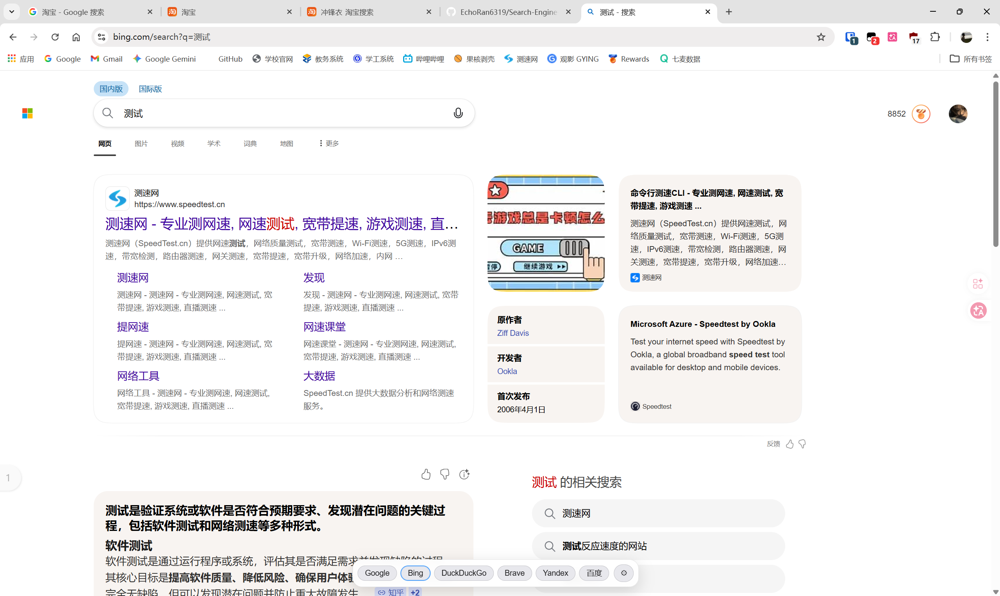
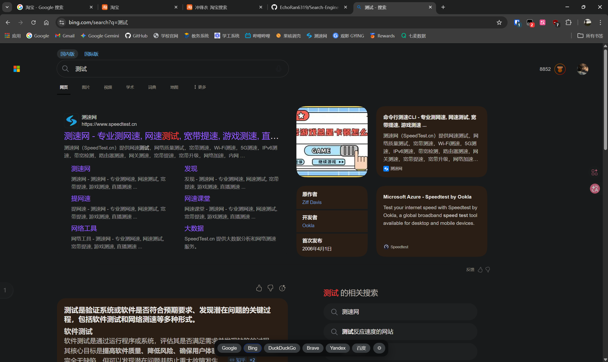
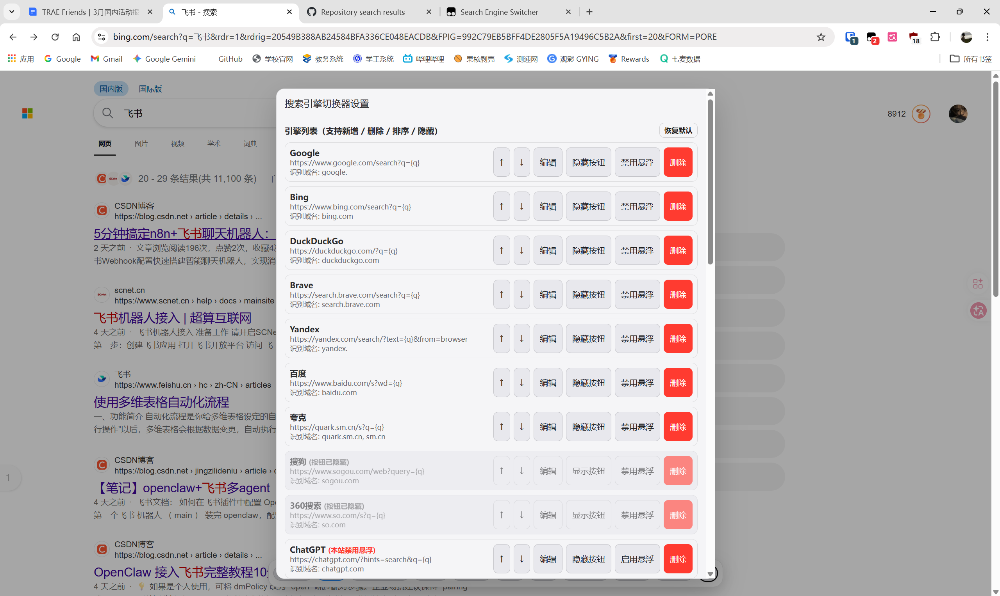
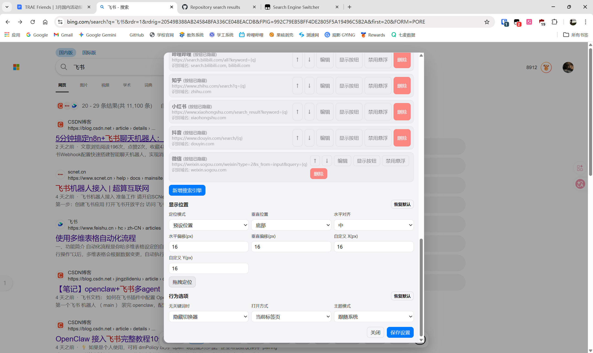

# Search Engine Switcher

[](https://greasyfork.org/zh-CN/scripts/570395-search-engine-switcher)
[](LICENSE)
[](https://www.tampermonkey.net/)

## 🚀 安装

### 方式一：Greasy Fork（推荐）

👉 [点击安装](https://greasyfork.org/zh-CN/scripts/570395-search-engine-switcher)

### 方式二：手动安装

1. 安装脚本管理器：[Tampermonkey](https://www.tampermonkey.net/) 或 [Greasemonkey](https://addons.mozilla.org/firefox/addon/greasemonkey/)
2. 点击 [Search-Engine-Switcher.js](./Search-Engine-Switcher.js) → "Raw"
3. 脚本管理器会自动提示安装

## 📸 界面展示

<p align="center">
  
  
</p>
<p align="center">
  
  
</p>

## ✨ 功能特性

- ⚡ **快速切换** - 保留当前搜索词，一键切换搜索引擎
- 🎯 **智能显示** - 只在搜索结果页/引擎首页出现，Gmail、百度百科、Google 翻译等“同域但非搜索页”不会乱弹
- 🖱️ **划词搜索** - 在搜索引擎页面选中文字即可带去其他引擎搜索（可关闭或放宽到所有网站）
- 📱 **自适应滚动** - 大量引擎时自动横向滚动，支持触屏滑动和鼠标滚轮
- 🔧 **高度自定义** - 添加/删除/排序/隐藏搜索引擎，按站点禁用悬浮窗
- 💾 **配置同步** - 支持导入导出 JSON 配置文件
- 🔄 **预设自动更新** - 脚本更新时自动迁移旧版预设的域名/搜索地址，不覆盖你的手动修改
- 🎨 **主题支持** - 跟随系统/浅色/深色模式，且不会污染网站自身的主题
- 🖱️ **灵活打开** - 左键切换，中键强制新标签页打开

### 支持的搜索引擎 (23)

| 类型 | 搜索引擎 |
|------|----------|
| 传统搜索 | Google, Bing, 百度, DuckDuckGo, Brave, Yandex, 搜狗, 360搜索 |
| AI 大模型 | ChatGPT, Perplexity, Gemini, 千问, 豆包, DeepSeek, Kimi, 秘塔AI |
| 社交/社区 | YouTube, GitHub, 哔哩哔哩, 知乎, 小红书, 抖音, 微信 |

##  使用方法

### 基本操作

| 操作 | 说明 |
|------|------|
| 左键点击 | 切换搜索引擎（跟随“打开方式”设置） |
| 中键点击 | 强制在新标签页打开 |
| 长按悬浮窗 / 点击 ⚙ | 打开设置面板 |

### 悬浮窗什么时候出现？

- **搜索结果页**：网址里带有该引擎的搜索关键词（如 `q=`、`wd=`、`text=`）时自动出现；
- **划词搜索**：在搜索引擎自己的页面（首页/搜索页）选中文字时出现，可一键带词换引擎；**在结果页选中文字时优先搜索选中的文字**（没有选区才沿用当前页面的搜索词）；
- **无关键词时**：在设置中开启“仍然显示切换器”后，引擎首页/搜索页常显。

普通网页，以及 **Gmail、Google 文档、百度百科、贴吧、Google 翻译、Google 地图** 这类“虽然属于搜索引擎域名、但并非搜索页”的页面默认不会出现悬浮窗。

### 设置面板

- **引擎列表** - 管理搜索引擎：新增、删除、排序、显示/隐藏按钮、启用/禁用本站悬浮
- **显示位置** - 预设位置或拖拽自定义（拖拽时按 Esc 取消）
- **行为选项** - 悬浮窗开关、无关键词时显示、选中文字时（不显示 / 仅搜索引擎页面 / 所有网站）、打开方式、主题模式

> 悬浮窗隐藏时，也可以通过浏览器脚本管理器（Tampermonkey 等）的菜单 → **搜索引擎切换器设置** 打开面板；菜单里还有 **使用指南** 和 **停用/启用悬浮切换器**。

### 默认启用

Google, Bing, DuckDuckGo, Brave, Yandex, 百度

## 🛠️ 技术架构

```
Search-Engine-Switcher.js
├── 配置管理 (GM_getValue/GM_setValue + presetVersion 预设迁移)
├── 显示状态机 (searchUrl 模板推导 host/path/查询参数)
├── 搜索引擎识别 (host 最具体匹配)
├── 搜索词提取 (模板参数/路径/hash + queryKeys 兜底)
├── 事件驱动渲染 (popstate/hashchange/pushState/selectionchange)
├── UI 渲染 (注入式 CSS + 固定定位 + 组件级主题隔离)
└── 初始化
```

### 核心代码片段

**搜索引擎识别（同一域名被多个引擎命中时取最具体的）：**
```javascript
function findEngineByHost(host) {
  let matched = null;
  let bestScore = -1;
  for (const engine of config.engines) {
    for (const pattern of engine.hosts || []) {
      const score = hostMatchScore(host, pattern);
      if (score > bestScore) {
        bestScore = score;
        matched = engine;
      }
    }
  }
  return matched;
}
```

**搜索词提取（由每个引擎的 searchUrl 模板自动推导，不再依赖全局参数白名单）：**
```javascript
function extractTemplateQuery(template, url) {
  if (template.mode === 'query') return cleanQuery(url.searchParams.get(template.param) || '');
  if (template.mode === 'path') {
    // 抖音 https://www.douyin.com/search/{q} 这类路径式搜索
    return cleanQuery(decodeUriSafe(url.pathname.slice(template.prefix.length)));
  }
  // hash 式同理
}
```

**显示门禁（只有搜索语境 / 划词 / 显式常显才显示）：**
```javascript
function computeWidgetState() {
  const url = new URL(location.href);
  const engine = findEngineByHost(url.hostname);
  // 1) 结果页：模板 host+path+查询参数同时命中
  // 2) 划词：仅在引擎首页/站内页面选中文字（可配置）
  // 3) 无关键词常显（可配置）
  // 选中文字、输入框内容不再单独作为显示条件
}
```

## ❓ 常见问题

**Q：为什么在 Gmail / 百度百科 / Google 翻译里选中文字，悬浮窗不出现了？**
A：这是 v2.6.0 的刻意修复。旧版会把这些“搜索引擎域名下的非搜索页”误判成搜索页，划词/输入框有内容就弹出悬浮窗。现在只有真正的搜索结果页（或你显式允许的划词场景）才会出现。

**Q：为什么在搜索引擎首页（还没搜索时）看不到悬浮窗？**
A：默认“无关键词时隐藏”，避免打扰。两种办法：① 在首页选中文字触发划词搜索；② 设置 → 行为选项 → 无关键词时 → 仍然显示切换器。

**Q：在搜索结果页选中一段文字再点其他引擎，会用哪段文字搜索？**
A：优先使用你选中的文字；如果没有选区，则沿用当前页面的搜索词（与划词搜索的说明一致）。

**Q：不想在某个网站看到悬浮窗？**
A：设置 → 引擎列表 → 找到对应引擎 → 点击“禁用悬浮”。如果只是不想划词唤起，把“选中文字时”改为“不显示”。

**Q：脚本更新后，我之前设置的搜索引擎会变吗？**
A：你在设置面板里手动修改/新增的引擎不会被覆盖。只有仍然是旧版默认值的预设地址/域名会自动迁移到新版本（例如 Kimi 更换域名）。

**Q：以前配置的引擎地址还能用吗？**
A：可以。加载旧配置时会自动做一次预设迁移；之后你也可以在设置面板用“恢复默认”彻底重置。

**Q：切换到 Gemini / 豆包后，关键词好像没有自动填进去？**
A：这两个站点官方没有提供“通过网址自动填入并提交问题”的能力（Gemini 的 `?q=` 会被忽略，豆包的网页版对 `?q=` 也不响应），所以点击后只会打开页面，需要手动粘贴问题。ChatGPT、千问、DeepSeek、Kimi 等可以通过网址预填，其中 ChatGPT 预填后仍需手动点击发送。

## 🌐 兼容性

- ✅ Chrome, Edge, Firefox
- ✅ Tampermonkey / Violentmonkey（推荐；支持 `GM_getValue` 同步存储）
- ✅ Greasemonkey 4+ 可用（无同步 API 时退化为按站点 `localStorage` 存储，配置不会跨站共享）
- ✅ 响应式布局
- ✅ 浅色/深色主题（组件级隔离，不会覆盖网站自身主题）

## 📜 更新日志

### v2.6.1
- 修复在搜索结果页选中文字后点击其他引擎时，仍然使用 URL 里的旧搜索词的问题：现在**优先搜索选中的文字**
- 修复“无关键词时仍然显示”模式下，点击引擎会把网址里的无关参数（如 `?p=2`）当成搜索词的问题
- 修复选区包含 emoji 或异常字符时点击引擎可能静默失败（编码报错）的问题；选区截断改为按码点安全处理
- ChatGPT / DeepSeek / Kimi / 千问 / 秘塔 / DuckDuckGo 等站点型引擎的登录、设置、定价、个人中心等工具页不再因划词而弹出悬浮窗
- 修复伪造域名（如 `google.evil.com`）在引擎首页划词时被误认为引擎站点的问题
- 同一引擎 400ms 内重复点击只打开一次（防双击开两个标签页）；点不同引擎不受影响
- 自定义坐标在按钮数量变化后会重新做视口内钳制，避免控件溢出屏幕
- 通过脚本管理器菜单停用/启用后，已打开的设置面板会同步状态，避免点保存时被覆盖
- 打开搜索前拦截 `javascript:` / `data:` 等危险协议（不删除你已有的自定义引擎配置，只阻止执行）
- DuckDuckGo 增加 `html.duckduckgo.com` / `lite.duckduckgo.com` 站点识别；`presetVersion` 升至 3

### v2.6.0
- **修复：在 Gmail、Google 文档、百度百科、贴吧、Google 翻译、Google 地图等非搜索页选中文字时悬浮窗莫名出现**（改为严格搜索语境判定，选中文字/输入框不再单独触发显示）
- 新增划词触发范围设置：不显示 / 仅搜索引擎页面（默认）/ 所有网站
- 修复 YouTube `search_query`、抖音路径式搜索词无法识别的问题；秘塔结果页 `question` 参数可识别
- 修复同一域名多引擎命中时的顺序问题（`weixin.sogou.com` 优先微信、`gemini.google.com` 优先 Gemini）
- 修复主题样式污染宿主页面 `data-theme` 的问题，主题变量/属性只作用于组件自身
- 渲染改为事件驱动：移除每 1.6 秒全量重建按钮，修复按钮点击竞态、滚动位置重置、GM 菜单开关失效
- 新增预设自动迁移（`presetVersion`）：老用户自动获得预设域名/地址修正，手动修改不受影响
- 修复设置面板重复打开监听器累积、引擎操作丢失未保存设置、无 Esc 关闭、拖拽与长按冲突
- 使用指南不再在安装/更新后自动弹窗（会被浏览器拦截），改为菜单/设置面板内打开
- 更新搜索引擎预设：Kimi 迁移至 `kimi.com`/`kimi.ai`；Perplexity 直达 `/search`；DeepSeek 支持 `autosend/search` 参数；GitHub 显式仓库搜索；知乎默认“综合”标签；小红书规范化地址；秘塔结果页 `question` 参数可识别

### v2.5.1
- 优化并补充使用指南，更详尽地说明了悬浮窗“在无搜索关键词时自动隐藏”的防打扰机制及自定义长显方法

### v2.5.0
- 修复深色模式下激活按钮描边样式不一致的问题
- 优化主题切换逻辑，确保移动端正确应用

### v2.4.0
- 通义千问更名为「千问」，更新搜索地址至 `qianwen.com`
- 移除夸克预设（夸克/神马搜索均无 PC Web 搜索界面）
- 修复深色模式下激活按钮描边被 Dark Reader 篡改的问题
- 代码清理：移除冗余函数与死代码

### v2.3.0
- 新增配置导入导出功能

### v2.2.0
- 横向滚动优化，支持鼠标滚轮
- 新增离线使用指南

### v2.1.0
- 支持鼠标中键新标签页打开
- 单站点禁用悬浮功能

### v1.0.0
- 初始版本发布

## 🙏 特别感谢

灵感来源于 [Via 浏览器](https://viayoo.com/) 的搜索引擎切换功能。

## 📄 许可证

[MIT License](LICENSE)

## 🤝 贡献

欢迎提交 Issue 和 Pull Request！
